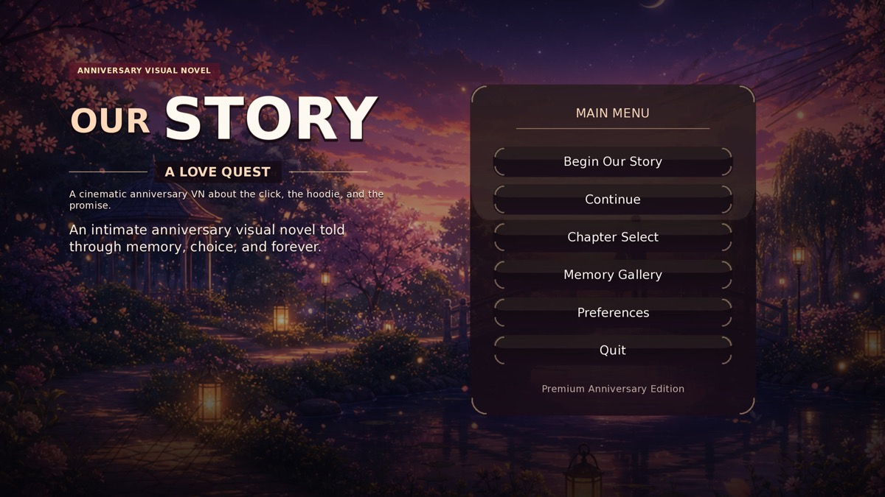
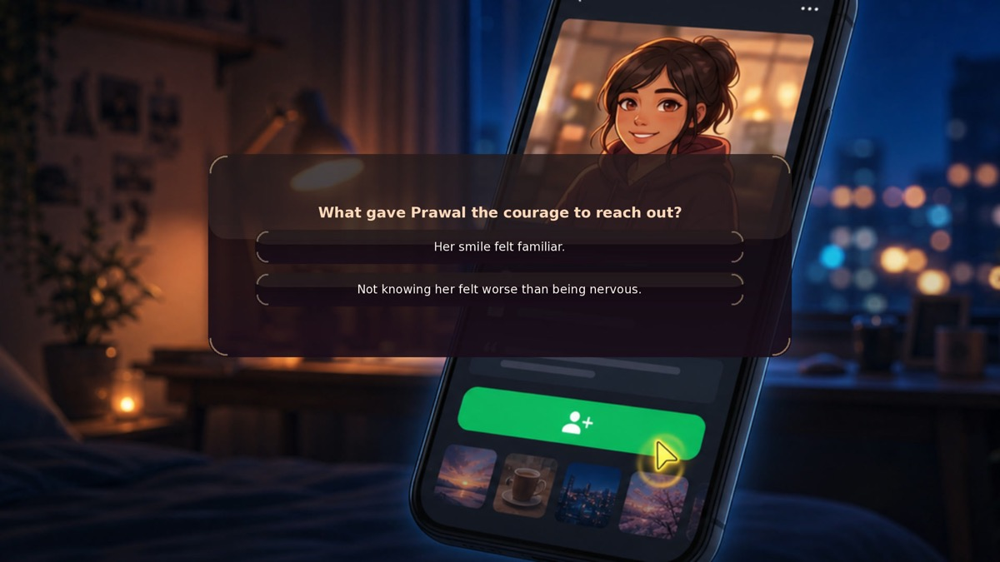

# Our Story: A Love Quest - Ren'Py Edition

> *Our Story: A Love Quest* — a Ren'Py visual novel with voice, audio mixing and an itch.io release pipeline.

**Download & play:** [prawalsharma.itch.io/praashi](https://prawalsharma.itch.io/praashi) (Windows, macOS, Linux)

<p align="center">
  
  
  
</p>


This is a sibling Ren'Py project generated from the existing Phaser project. The Phaser project remains unchanged.

## Source of Truth

- Story data: ../anniversary-game/src/data/story.json
- Generated assets: ../anniversary-game/Assets for Game
- Original photos: ../anniversary-game/Anniversary - Wedding

## Regenerate Script

Run from this folder after changing the Phaser story JSON:

```bash
npm run generate
```

## Run

Open this folder from the Ren'Py launcher, or run it with a local Ren'Py SDK if installed.

## Local Node Tooling

Node/npm is used for local build and generation tasks only (not game runtime).

```bash
npm install
npm run check:source
npm run generate
```

Install additional npm packages as needed and import them inside `tools/*.js`.

## Voice Generation

Voiceover uses Edge TTS as an explicit development-time generation step. This sends dialogue text to the Edge/Microsoft TTS service only when the voice generation command is run.

Install the Edge TTS CLI before generating audio:

```bash
python3 -m pip install edge-tts
```

```bash
npm run generate:voice-manifest  # scan script.rpy and write the local voice manifest only
npm run generate:voice           # generate/warm OGG voice files and inject Ren'Py voice statements
npm run inject:voice             # re-inject existing generated voice statements after script regeneration
```

Voice settings live in `tools/voice_config.json`. Runtime OGG files and `game/audio/voice/manifest.json` live under `game/audio/voice/`. Set `EDGE_TTS_BIN` if the `edge-tts` executable is not on PATH.

## Deployment

This app is deployed as a Ren'Py distribution, not as a Node web app:

1. Open the project in Ren'Py Launcher.
2. Select **Build Distributions**.
3. Choose target packages (Windows, macOS, Linux, or market bundle).
4. Upload the generated files from the `*-dists` output folder to your release channel (for example itch.io or Steam).

The npm toolchain is a pre-build step used during development. It is not bundled as a runtime dependency in shipped Ren'Py builds.
